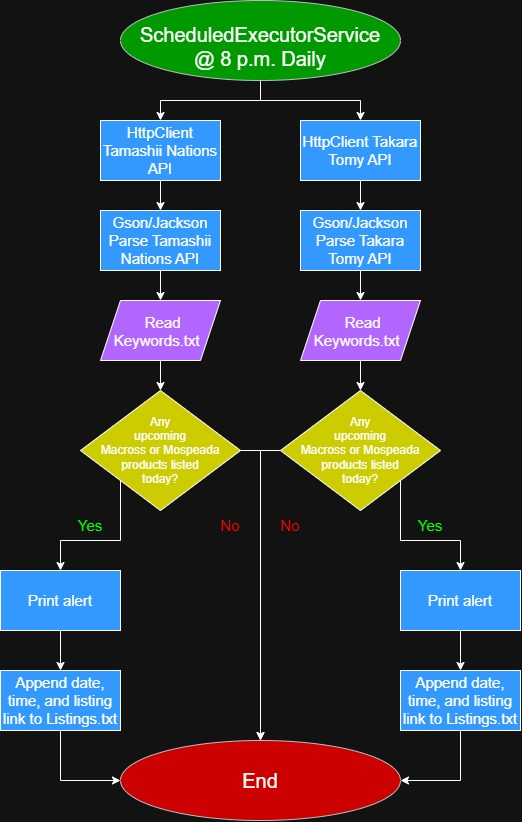

# CS-19300-Final-Project
This project is a program that keeps track of new Macross and Mospeada toy announcements on select websites daily and notifies me of a new announcement and provides me a link to the product listing if one comes up.

## The Problem
I like to collect transforming robot toys from the series Macross and Mospeada. However, keeping track of upcoming releases is exhausting, as I constantly have to remember to google updates every so often. I seek to find a way of getting these updates delivered to me.

## How It Works
- Accesses and parses the API the announcements webpages of Tamashii Nations/Bandai and Takara Tomy.
- Browses the webpages and keeps track of any new listings the moment they are added to the webpages.
- Identifies the desired listings based on keywords related to Macross or Mospeada from Keywords.txt..
- Prints in terminal a notification of a new announcement of a Macross or Mospeada product.
- Appends to Listings.txt. date, time, and listing link.

## Tech Stack
- **Language:** Java
- **External libraries:** N/A
- **Data Storage:** Plain Text File
- **External sources:** Tamashii Nations’ and Takara Tomy’s announcements webpages.
- **Accessing the sources:** Use Java’s HttpClient library.

## Roadmap
- [ ] Browse more companies’ webpages (Threezero, Kitzconcept, Sentinel, Pose+, Moshow Toys).
- [ ] Browse the official social media accounts of Macross and Robotech for any announcements.
- [ ] Add more keywords for the software to go off of when browsing the webpages.

## Author
Andrew Zhang, https://github.com/Andy-Zhang11
