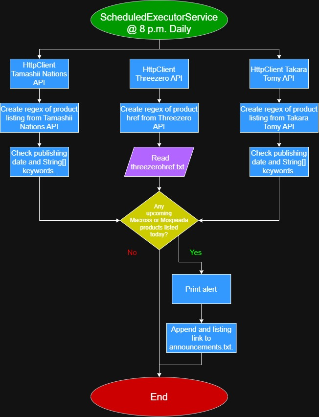

# CS-19300-Final-Project
This project is a program that keeps track of new Macross and Mospeada toy announcements on select websites daily and notifies me of a new announcement and provides me a link to the product listing if one comes up.

## The Problem
I like to collect transforming robot toys from the series Macross and Mospeada. However, keeping track of upcoming releases is exhausting, as I constantly have to remember to google updates every so often. I seek to find a way of getting these updates delivered to me.

## How It Works
- Accesses the announcements webpages of Tamashii Nations/Bandai and Takara Tomy/T-Spark at 8 pm daily.
- Browses the webpages and keeps track of any new listings the moment they are added to the webpages.
- For Takara's and Bandai's websites: Identifies the desired listings based on keywords related to Macross or Mospeada from String array "keywords".
- Prints in terminal a notification of a new announcement of a new Bandai or Takara product.
- Appends to announcements.txt. date and listing link.



## Tech Stack
- **Language:** Java
- **External libraries:** N/A
- **Data Storage:** Plain Text File
- **External sources:** Tamashii Nations’ and Takara Tomy’s announcements webpages.
- **Accessing the sources:** Use Java’s HttpClient library.

## Setup
1. Clone the Github repository to your computer.
2. Open terminal and change your directory to the destination of the cloned repository.
3. Change your directory again to the cloned repository.

```bash
git clone https://github.com/Andy-Zhang11/CS-19300-Final-Project
cd path/to/your/destination-folder
cd CS-19300-Final-Project
```

## Usage
1. Verify Java Development Kit 11 or newer is installed on your machine.
2. Verify that the Java source code is in the src file.
3. If it doesn't exist, create a directory named bin.
4. Compile the Java source code and place the file in the bin directory.
5. Execute the ToyAnnouncementsNotifier class.

```bash
java -version
javac -version
ls src
mkdir -p bin
javac -d bin src/*.java
java -cp bin ToyAnnouncementsNotifier
```

## Roadmap
- [X] Expand to Robotech-branded products by browsing Threezero's website, specifically their list of Robotech products.
- [ ] Browse the official social media accounts of Macross and Robotech for any announcements.
- [ ] Add more keywords for the software to go off of when browsing the webpages.

## Author
Andrew Zhang, https://github.com/Andy-Zhang11
